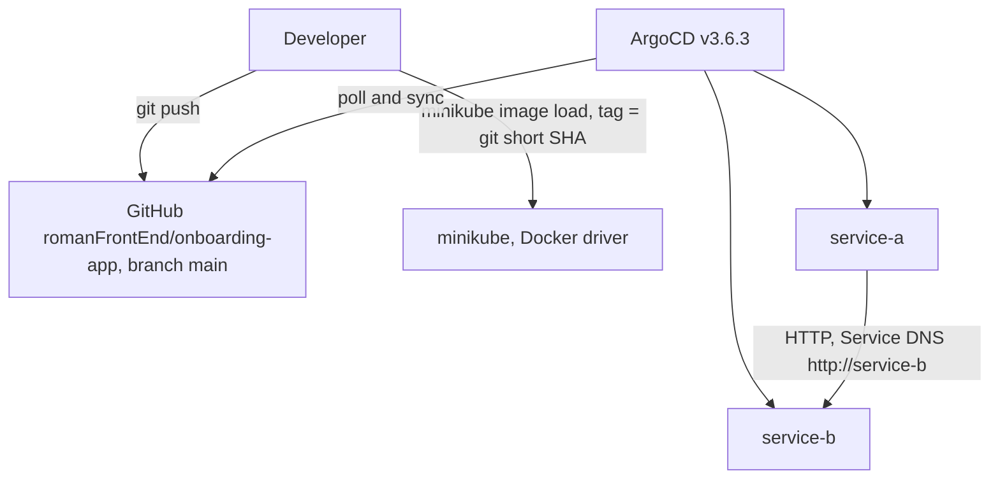

# onboarding-app

Reference implementation for Jira ticket **B2-5095**: two Quarkus services talking HTTP, deployed to a local minikube cluster and managed declaratively by ArgoCD from this repository.

- **service-a** (caller): `GET /api/v1/combined?name=Roman` calls service-b and returns a combined result.
- **service-b** (callee): `GET /api/v1/hello?name=Roman` returns a greeting.



## Prerequisites

Docker Desktop (running), `minikube`, `kubectl`, `git`, Maven, JDK 21. `gh` is only needed for `release.sh --push`.
The scripts pick JDK 21 on macOS with `/usr/libexec/java_home -v 21`; set `JAVA_HOME` yourself on other systems.

## Quick start

```bash
make up          # minikube profile "onboarding", ArgoCD (pinned), both images, root Application
make status      # ArgoCD applications and pods
make forward     # service-a on http://localhost:8080 (port-forward)
curl -H "X-Transaction-Id: demo-1" "http://localhost:8080/api/v1/combined?name=Roman"
make down        # deletes the minikube profile and everything in it
```

`make up` builds each image at the tag pinned in Git, loads it into the cluster, then applies `deploy/argocd/root.yaml`. A tag pinned in Git always exists in the cluster before ArgoCD deploys it.

## Verify the acceptance criteria

| AC | How to see it |
|---|---|
| 1 Service DNS, URL is config | `kubectl -n onboarding get deploy service-a -o yaml` shows `SERVICE_B_URL=http://service-b` |
| 2 Probes | Deployments declare `/q/health/ready` and `/q/health/live`. service-a stays ready when service-b is down |
| 3 Slow or unavailable service-b | `kubectl -n onboarding scale deploy/service-b --replicas=0`, then call service-a: 503 `SERVICE_B_UNAVAILABLE`. ArgoCD `selfHeal` restores the replica within seconds; pause auto-sync on `service-b` to keep it down |
| 4 Immutable tags | `make release SERVICE=service-b ARGS="--push"` builds, loads, pins the new tag in Git; ArgoCD rolls it out |
| 5 Applications in Git | `deploy/argocd/`; `make status` shows Synced and Healthy |
| 6 Overlays | `deploy/overlays/local` (deployed) and `deploy/overlays/example` (2 replicas, DEBUG log, 3000 ms timeout): `kubectl kustomize deploy/overlays/example/service-a` |
| 7 Tracing | the `X-Transaction-Id` header is propagated and logged; one is generated when absent. `kubectl -n onboarding logs deploy/service-b \| grep demo-1` |
| 8 Tests without service-b | `cd services/service-a && mvn test` (WireMock) |
| 9 Reproducible | `make up` from a clean machine with the prerequisites above |
| 10 Credentials never committed | see "Private repository" below |

## Releasing a new version

```bash
make release SERVICE=service-a                 # build, load, pin the tag in deploy/overlays/local (no commit)
make release SERVICE=service-a ARGS="--commit" # also commit the tag bump
make release SERVICE=service-a ARGS="--push"   # commit and push to main (set DEPLOY_BRANCH to override)
```

The tag is the short SHA of the last commit touching `services/<service>`. The order is enforced: build, load, confirm the image in the cluster, only then change Git. If any step fails, nothing is committed.

## Private repository

The repo is public, so ArgoCD needs no credentials. For a private fork, export a token before `make up`:

```bash
export GITHUB_TOKEN=$(gh auth token)   # or a fine-grained token with read access to the repo
make up
```

`scripts/up.sh` then creates the ArgoCD repository secret straight into the cluster. The token is read from the environment and never written to any file in this repository.

## Layout

| Path | Content |
|---|---|
| `services/service-a`, `services/service-b` | Quarkus 3.40 services (Java 21), tests, Dockerfile |
| `deploy/base`, `deploy/overlays`, `deploy/argocd` | Kustomize base, overlays, ArgoCD Applications |
| `deploy/local-config.json` | Input of the local configuration renderer (Confys Local) |
| `scripts/`, `Makefile` | `up`, `down`, `release` |
| `doc/spec/B2-5095/spec.md` | Functional specification (approved) |
| `doc/plan/B2-5095/plan.md` | Implementation plan and its deviations |
| `doc/test/B2-5095/test-report.md` | Verification report with the conformance matrix |
| `docs/adr/` | Architecture decisions |

The files under `deploy/` and `scripts/` are generated from templates. Change `deploy/local-config.json` and re-render rather than editing them by hand.

## Tests

```bash
cd services/service-a && mvn test   # 57 tests: Cucumber with WireMock, unit
cd services/service-b && mvn test   # 18 tests
```

## Decisions

- [ADR 0001: image delivery to the cluster](docs/adr/0001-image-delivery.md)
- [ADR 0002: local cluster](docs/adr/0002-local-cluster.md)
- [ADR 0003: manifest tooling](docs/adr/0003-manifest-tooling.md)
- [ADR 0004: repository layout](docs/adr/0004-repo-layout.md)
- [ADR 0005: resilience approach](docs/adr/0005-resilience.md)
- [ADR 0006: image tagging and promotion](docs/adr/0006-tagging-and-promotion.md)
