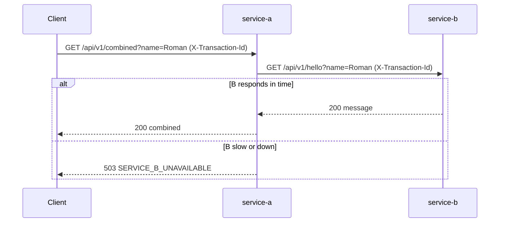
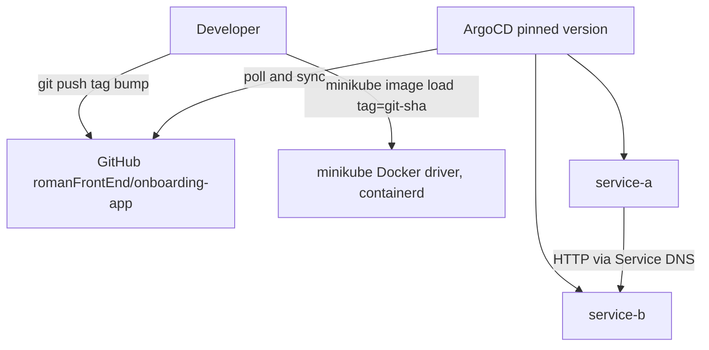

# MS service-a + service-b - Two Quarkus services on local minikube via ArgoCD: Functional Analysis

## Change Log
|  Version |   Date   | Change Description | Project/Feature | Author | Squad |
|----------|----------|--------------------|-----------------|--------|-------|
| 0.6 | 2026-11-25 | Spike evidence: image delivery High, ArgoCD pinned, AC coverage matrix added | Onboarding 26-Pi3/Pi4 | Roman | n/a |
| 0.7 | 2026-11-25 | Retry rule defined (timeouts and connection errors only, never 4xx/5xx), timeout and retries made configuration, worst-case latency documented. Decided by the Developer while reviewing the Gherkin scenarios | Onboarding 26-Pi3/Pi4 | Roman | n/a |

## Information Gaps

| Information Gap | Impact on Analysis | Resolution Status |
|-----------------|-------------------|-------------------|
| Repo name and visibility | ArgoCD `repoURL`, AC10 | Assumed `romanFrontEnd/onboarding-app`, public (name verified free). [NEEDS VERIFICATION] |
| Retry and timeout default values | AC3 | Defaults 2s timeout and 2 retries, confidence Low. Now configuration (`SERVICE_B_TIMEOUT`, `SERVICE_B_RETRIES`), so changing them needs no spec change. |
| End-to-end tag-bump flow on our own repo | AC4/AC5 | Verified in pieces by the spike. Final proof on first build. |
| Intent artifact `doc/intent/B2-5095` | Spec cannot trace to an accepted intent | Open, a process item |
| Analyst name for dual approval | SDLC & PRACTICES, phase 2 | Open |
| Ingress | Not needed | Out of scope per the ticket |

## Pending Issues

None beyond the gaps above.

## Service Information

### Description
Two Quarkus reference services. Service B returns a greeting. Service A calls B over HTTP and returns the combined result. Both run on a local minikube cluster and are deployed by ArgoCD from GitHub. The pair serves as a reusable template for future services. (Confidence: High, from B2-5095)

### Usage Context
A developer runs `make up`, calls service A through `kubectl port-forward`, and upgrades a service by running `scripts/release.sh` and letting ArgoCD sync.

### Sequence Diagram


### Component Diagram (link to the architecture)


### Technical Information
| Type of information | Name/location |
|---------------------|---------------|
| Service name | `service-a`, `service-b` (Quarkus, Java 21 Zulu, arm64) |
| Virtual service name | `service-b.<ns>.svc.cluster.local:80` |
| Repo BitBucket/GIT | `github.com/romanFrontEnd/onboarding-app` (monorepo, public, assumed) |

### API contract (proposed)
| Service | Endpoint | Success response |
|---|---|---|
| B | `GET /api/v1/hello?name={name}` | `200 {"message":"Hello, Roman","service":"service-b","version":"1.0.0"}` |
| A | `GET /api/v1/combined?name={name}` | `200 {"name":"Roman","service-a":{...},"service-b":{...}}` |

Health endpoints are `/q/health/live` and `/q/health/ready`. The readiness of A does not depend on B.

## Validation Process

1. A requires `name` (non-blank, at most 50 characters). Otherwise it returns 400 `INVALID_REQUEST`.
2. A reads the B URL from the `SERVICE_B_URL` configuration.
3. A calls B with a timeout of `SERVICE_B_TIMEOUT` (default 2s) and up to `SERVICE_B_RETRIES` retries (default 2) with backoff.
4. A retries only on timeouts and connection errors. It never retries on a 4xx or 5xx answer from B.
5. A builds the combined response.

Worst-case response time when B is down: (`SERVICE_B_RETRIES` + 1) x `SERVICE_B_TIMEOUT` plus backoff, about 6s plus backoff with the defaults.

## Mapping and Transformation Rules

### List of backend input fields
| Field's name (backend) | Payload's field name (received) | Transformation Rules | Comment |
|------------------------|--------------------------------|--------------------|--------|
| `name` | `name` | Pass-through | Query parameter |
| `X-Transaction-Id` | `X-Transaction-Id` | Pass-through, generated if absent | Correlation ID (AC7) |

### List of backend output fields
| Payload's field name (returned) | Field's name (backend) | Transformation Rules | Comment |
|--------------------------------|----------------------|--------------------|--------|
| `service-b.message` | `message` | Pass-through | |
| `service-b.version` | `version` | Pass-through | |
| `service-a` | n/a | Added by A | A's own block |

## Error Management

| HTTP Code from Backend | HTTP Code returned by BSI | HTTP Status message | Error Code from Backend | Error Code returned by BSI | Reason |
|------------------------|--------------------------|---------------------|------------------------|----------------------------|--------|
| timeout or connection refused | 503 | Service Unavailable | n/a | `SERVICE_B_UNAVAILABLE` | B slow or scaled to 0 |
| 5xx | 502 | Bad Gateway | n/a | `SERVICE_B_ERROR` | B failed |
| n/a | 400 | Bad Request | n/a | `INVALID_REQUEST` | Missing or invalid `name` |

**Example of an error payload**
```json
{
   "code": "SERVICE_B_UNAVAILABLE",
   "reason": "service-b did not respond in time",
   "@type": "ErrorRepresentation"
}
```

## Technical Integration with the backend
| Backend's name | Type of backend (MQ, BD, service Rest, ...) |
|----------------|---------------------------------------------|
| service-b | service Rest |

### Backend Configuration by Environment

| Environment | Server/BD/MQ Name | Authentication Information | Service Called | Method |
|-------------|------------------|---------------------------|--------------|--------|
| local | `http://service-b` | None | `/api/v1/hello` | GET |
| example (overlay) | `http://service-b` (differs in replicas, log level, timeout) | None | `/api/v1/hello` | GET |

### Image delivery and deployment order (verified by spike)
1. `scripts/release.sh <service>` builds the image `service-x:<git-sha>`, runs `minikube image load`, confirms it with `minikube image ls`, updates the tag in `deploy/overlays/<env>`, then commits and pushes with `-c credential.helper='!gh auth git-credential'`.
2. A tag is never committed before the image is confirmed in the cluster.
3. Deployments use `imagePullPolicy: Never`, and minikube keeps its default containerd runtime.
4. Optional: pin the image by digest in addition to the tag.
5. `make up` runs `minikube start --driver=docker --cpus=3 --memory=4g`, installs ArgoCD at a pinned version, and applies the root Application. `make down` runs `minikube delete`.
6. For a private repo, bootstrap reads `GITHUB_TOKEN` from the environment and creates the ArgoCD repo secret. It is never committed. A public repo needs none (AC10).

## Logging

- The names under which they are logged:
  - `service`
  - `operation`
  - X-Transaction-Id
  - `status`
- Log backend name (`backend=service-b`)
- After calling the service, log the execution time in milliseconds

### Grafana Dashboard — Suggested Panels
> 💡 The panels listed below are suggestions based on the analyst's understanding of the service behavior. The developer determines what is technically feasible to implement.

- **Throughput and latency (p95/p99) per operation** — requests per second and p95/p99 latency for `combined` and `hello`. Healthy: stable throughput, p99 below the 2s backend timeout.
- **service-b backend health** — call rate, latency and error rate of A's calls to B. Healthy: error rate near zero, latency well under the timeout.
- **Error breakdown** — three buckets: backend issue (`SERVICE_B_UNAVAILABLE`, `SERVICE_B_ERROR`), internal issue, expected behaviour (`INVALID_REQUEST`).

## Assumptions

| Item | Description | Confidence Level | Required Clarification |
|------|-------------|------------------|------------------------|
| Cluster | minikube, Docker driver, containerd | High (spike-verified) | None |
| Image delivery | `minikube image load`, git-SHA tags, `imagePullPolicy: Never` | High (spike-verified, negative and positive tests) | None |
| ArgoCD from GitHub | ArgoCD syncs from GitHub on arm64 minikube | High (spike-verified) | None |
| Layout | Monorepo: `services/`, `deploy/{base,overlays}`, `deploy/argocd`, `scripts/`, `docs/adr`. Differs from the BSI separate-config-repo convention | High (flagged) | None |
| GitOps source | GitHub, public, `onboarding-app` | Medium (access verified) | Confirm name and visibility |
| Build order | Alfie, Teddy (RED tests first), Cody, Confy (SDLC & PRACTICES, phase 6) | High | None |
| Dual approval | Analyst and Developer approval noted in the Jira task (SDLC & PRACTICES, phase 2) | High | Analyst name |
| Not applicable | SDLC phases 8-13, Connection Checker, TIGLIV/TBP via Trixie (WM-migration and real-environment steps only) | High | None |
| JDK | Zulu 21 via `JAVA_HOME`, shell default is 17 | High | None |
| Resilience defaults | 2s timeout, 2 retries, configurable. Retry only on timeouts and connection errors | Low (values), High (retry rule, decided by the Developer) | Confirm values |

## Open Questions

1. Confirm repo name `onboarding-app` and public visibility.
2. Keep timeout 2s and 2 retries?
3. Who is the Analyst for the dual approval?

## Acceptance Criteria Coverage

| AC | Covered by |
|---|---|
| 1 Service DNS and config URL | Technical Information, Validation Process step 2 |
| 2 Probes | API contract (health endpoints) |
| 3 Slow or down B | Error Management, Validation Process step 3 |
| 4 Immutable tags | Image delivery and deployment order |
| 5 Apps in Git, Synced/Healthy | Image delivery step 5 |
| 6 Overlays | Backend Configuration by Environment (`local`, `example`) |
| 7 Correlation ID | Mapping rules, Logging |
| 8 Client tests without B | Gherkin scenarios and Teddy's tests |
| 9 Clean-machine bootstrap | `make up` and `make down`, pinned versions |
| 10 Credentials not committed | Image delivery step 6 |
